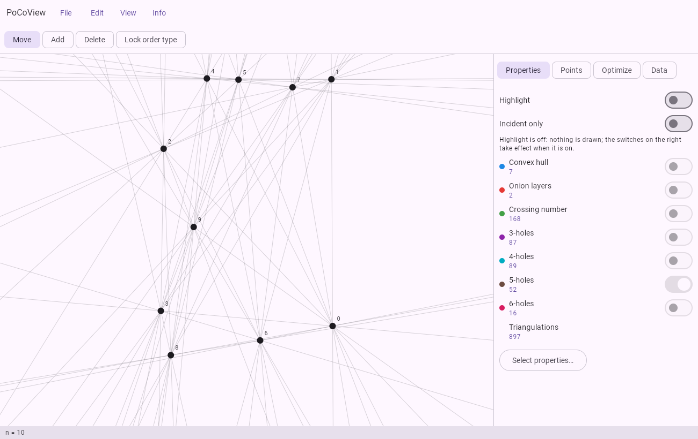

# PoCoView

Point Configuration Viewer: look at, edit and analyze planar point sets and their order types,
right in the browser.

**Web app:** https://manfredscheucher.github.io/PoCoView/

Drag points around and watch how convex hull, onion layers, crossing number, k-holes, k-gons and the
number of triangulations change. Lock the order type to move points only inside their cell of the
line arrangement, restrict everything to the structures through one point, and minimize or beautify
coordinates without changing the order type. Coordinates can also be pasted or edited directly as
text. Reads and writes the usual formats, including the order type database files (`.b08`, `.b16`,
`.b32`).

PoCoView is the successor of qtvis (a C++/Qt point set visualizer) and of the editor of pyotlib2
(Python order type library). It is written in Kotlin Multiplatform (Compose) and also runs as a
desktop app.

- Features: [doc/USER_GUIDE.md](doc/USER_GUIDE.md)
- Building, testing, deploying: [doc/DEVELOPMENT.md](doc/DEVELOPMENT.md)

Example data: `data/otypes/` (all order types for n = 3..8), `data/posezo/`.

## License

MIT, see [LICENSE](LICENSE).
