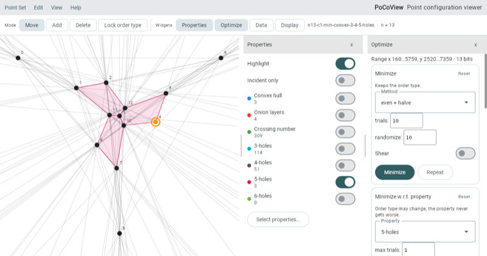
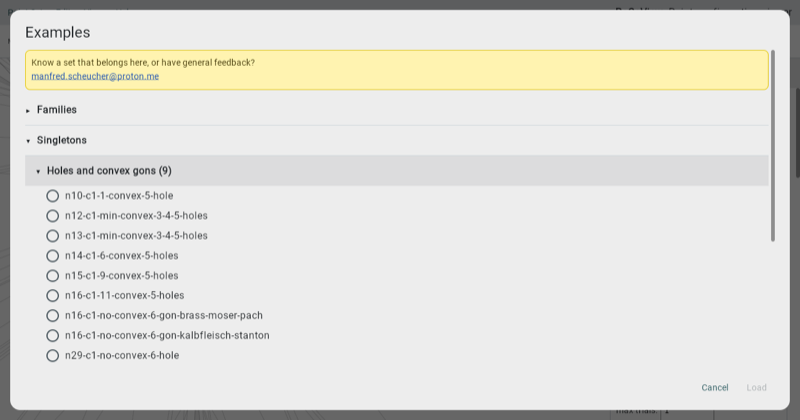
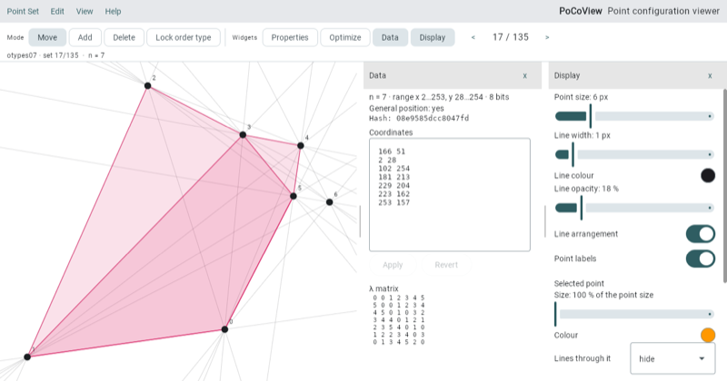
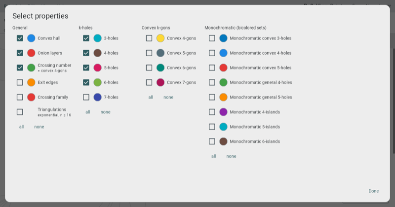

# PoCoView user manual

PoCoView is a viewer and editor for point sets in the plane. You change a point set by dragging
points and look at its combinatorial properties. It runs in the browser
(https://scheucher.dev/PoCoView/) and as a desktop app; both work the same, except
where this manual says otherwise.

## What you can do

- Load example sets: generated families, sets from the literature, all order types of 3 to 7 points.
- Paste, open and save point sets as JSON or text, open the order type database files (`.b08` etc.).
- Browse files that hold several point sets, one set at a time.
- Make a random point set in general position.
- Drag, add and delete points; undo and redo.
- Lock the order type, so a dragged point cannot leave its cell of the line arrangement.
- Snap points into a cell that contains no grid point (grid refinement).
- Show the line arrangement, point labels and the lines through the selected point.
- Count and highlight properties: convex hull, onion layers, crossings, holes, convex gons, exit
  edges, crossing family, monochromatic holes and islands; count triangulations.
- Count only the structures through the selected point (Incident only).
- Minimize or beautify the coordinates without changing the order type.
- Search for a configuration with a smaller value of a property.
- Edit the coordinates as text; see the λ matrix and the order type hash.
- Export a picture as SVG or Ipe.
- Change how points and lines are drawn; the settings are remembered.

## Basics

- Points have integer coordinates, the y axis points up. Coordinates must stay within ±2^29.
- The order type of a point set says, for every three points, whether they turn left or right.
- The line arrangement is the line through every pair of points. Its cells are the regions in which a
  point can move without changing the order type.
- The set should be in general position (no three points on a line). Points on a common line get a
  red ring, the toolbar says "NOT in general position", and the properties and optimizers wait until
  that is fixed.

## The screen

- Menu bar: Point Set, Edit, View, Help. On narrow screens it scrolls sideways.
- Toolbar: the mode (Move, Add, Delete), Lock order type, the widget buttons, the set arrows `<` `>`
  for files with several sets, and the status: file name (with "set i/n"), n, the general position
  warning and the last message. Messages like "Loaded …" or "Saved …" fade after 3 s; optimizer
  results stay until the next message or edit. When the row is full, the status moves to a line of
  its own.
- Canvas: the points, the line arrangement and the highlighted structures.
- Widgets: Properties, Optimize, Data and Display, next to or below the canvas. At the first start
  Properties and Optimize are open, and the start set is the example n13-c1-min-convex-3-4-5-holes.

At the first start a Welcome dialog says what PoCoView is for; Examples opens the examples, Start
closes it, "Don't show again" turns it off. Errors (a file or text that cannot be read) open an
Error dialog.

## Load point sets

All of these are in the Point Set menu.

**Examples...** is a tree; every node opens and closes with a click:

- Database: all order types of 3 to 7 points (Graz order type database). The selected file shows
  its description, the number of the order type, and last the link to the database website. Choose
  the number of the order type ("order type: 17 of 135"; a number out of range disables
  Load). The whole file is loaded, so you can step through the other order types with `<` `>`.
- Extremal point sets: sets from papers and from PoSeZo, in groups (holes and convex gons, crossing
  number, bicolored sets, crossing families, universal point sets, miscellaneous). The selected set
  shows its description and note, then its sources: reference and links.
- Families: generated sets; the selected family shows its description, n, then its references. Horton set (no empty convex 7-gon; n is rounded up to the next power
  of 2) and Convex position (points on the moment curve). Set n with the number field or `−`/`+`
  (default 16).
- Links: PoSeZo.

Select an entry, then Load. Closing the node that holds the selection clears it. While the app runs,
the dialog keeps its open nodes, selection, numbers and scroll position. The yellow box has a mail address for sending interesting sets or feedback.

**Random...** makes n random points in general position with coordinates from 0 to grid − 1 (n from 1
to 200, default 12; grid from 2 to 2^29, default 1000), then Generate.

**Import...** reads pasted text, one or more sets; the format is detected (see
[File formats](#file-formats)).

**Open file...** reads `.json`, `.txt`, `.asc`, `.psz` and the order type database files `.b08`,
`.b16`, `.b32` (also `.pb08`, `.pb16`, `.pb32`). On the web this uses the browser's file picker. On
the desktop the file chooser starts with the JSON filter; choose "All point sets" for the others.

### Several sets

A file or pasted text can hold several sets. Then one set is shown at a time: the toolbar shows the
arrows `<` `>` with "i / n" between them, and the status says "set i/n"; PageUp/PageDown (or `,` and
`.`) do the same. After loading, a dialog says how many sets were loaded ("Don't show again" turns it
off). Edits to a set are kept when you switch to another one; switching clears the undo history.

### Unsaved changes

If the points changed since they were loaded or saved, Load (Examples), Import, Generate (Random) and
Open file first ask "Save changes?": Save JSON or Save text saves and goes on, Discard goes on without
saving, Cancel stops. A cancelled or failed save stops too. On the desktop, closing the window (or
Cmd+Q) asks the same. The browser does not ask when you close the tab. An unapplied edit in the Data
widget is never saved: if it is the only change, the dialog offers just Discard and Cancel. Switching
sets asks this too.

## View and navigate

- Zoom with the mouse wheel (at the pointer), by pinching, with `+`/`-`, or View → Zoom in / Zoom out.
- Pan by dragging empty space, or with two fingers.
- Fit: View → Fit, Home or `0`.
- Until you zoom or pan, the view fits the points again whenever the canvas changes size (window,
  widgets, dividers, layout). After a zoom or pan it stays. Fit, loading, Apply, switching sets and
  the coordinate optimizers fit again and turn the automatic fit back on. Editing points does not
  count as zooming or panning.
- View → Line arrangement (`L`) and View → Point labels switch the lines and the point numbers on
  and off. Points are numbered from 0, in the order of the coordinate list.
- The selected point is drawn orange with a ring. By default the lines through it are hidden,
  so you see its cell (Display widget, "Lines through it": hide, normal or highlight).
- Points with the colour `R`, `B` or `G` (also lower case) are drawn red, blue or green; all other
  points black.

## Edit points

The mode in the toolbar sets what a click on the canvas does:

| Mode | Key | Click | Drag a point |
|---|---|---|---|
| Move | V | select a point, or deselect on empty space | move it |
| Add | A | add a point on empty space, select an existing point | move it |
| Delete | D | delete the point | pans the view |

- A new point goes to the nearest grid point and is selected. It is refused (with a message) if it
  would be on a line with two other points or on top of another point. A point cannot be dragged
  onto another one.
- Right-click a point (long press on touch screens, Ctrl+click on a Mac) for a small menu headed
  "Point i": Select, Delete. Right-click on empty space does nothing. The desktop app has no long
  press.
- Del or Backspace (or Edit → Delete selected point) deletes the selected point. Esc deselects.
- Undo and Redo are in the Edit menu (Ctrl+Z, Ctrl+Shift+Z or Ctrl+Y). A whole drag, and a whole
  optimizer run, is one undo step. Loading a set clears the history.

**Lock order type** (toolbar, Edit menu, `F`): a dragged point cannot leave its cell of the line
arrangement, so the order type stays the same. While points are collinear it has no effect, and the
status says so.

**Snap with grid refinement** (Display widget, under Editing, off by default): sometimes a cell is
visible but contains no grid point. With this switch on, when you drop or add a point it goes to the
nearest of the 4 grid points around the pointer that lies in the cell you aimed at. If none does,
all coordinates are doubled (the view zooms out by as much, so the picture stays) and the 4 grid
points are tried again, until one fits. With Lock order type, a drop outside the point's cell changes
nothing. Undo takes back the doubling but not the zoom. Coordinates stay exact integers within
±2^29; if there is no room, the status says so.

To edit the coordinates as text, see [Data](#data).

## Widgets and layout

The widget buttons in the toolbar, View → Properties (1) … Display (4) and the keys `1` to `4` show
and hide the widgets. The x in a widget's title closes it.

- Wide window: each open widget is a column right of the canvas, in the order they were opened.
  Narrow window: they are stacked below the canvas. Layout auto/portrait/landscape (View menu or
  Display widget) forces one of them; auto uses the width.
- All dividers between canvas and widgets can be dragged.
- At most "Max. widgets" are open (Display widget, 1 to 4, default 2). Opening one more closes the
  one that was clicked least recently.
- If the window is too narrow for the canvas and the columns, the columns scroll sideways.

## Properties

The Properties widget lists the chosen properties with their values. Choose them in View → Select
properties... (or the button at the bottom of the widget): one checkbox per property, "all" and "none"
per group, and a colour dot that sets the highlight colour.

| Property | Meaning |
|---|---|
| Convex hull | number of points on the convex hull |
| Onion layers | number of nested convex layers (peel the hull off repeatedly) |
| Crossing number | crossings of the complete straight-line graph = number of convex 4-gons |
| Exit edges | edges whose witness point can cross them alone; their orientations determine the order type |
| Crossing family | largest set of pairwise crossing segments, drawn red and bold; up to n = 50 |
| k-holes | empty convex k-gons (no point inside), k = 3 to 7 |
| Convex k-gons | k points in convex position, k = 4 to 7 |
| Triangulations | number of triangulations; slow, up to n = 16; count only |
| Monochromatic convex k-holes | empty convex k-gons with all vertices of one colour, k = 3 to 5 |
| Monochromatic general k-holes | the same for simple polygons that need not be convex, k = 4, 5 |
| Monochromatic k-islands | k points of one colour with no other point in their convex hull, k = 4 to 6 |

Shown by default: convex hull, onion layers, crossing number, 3- to 6-holes; only the 5-holes have
their highlight switch on. The monochromatic properties need a colour for every point (two-coloured
sets, see Bicolored sets in the Examples) and work up to n = 200. While a value is computed it says
"computing…"; a property that cannot be computed says why ("not in general position", "n > 16",
"needs a coloured set").

- **Highlight** (`H`, off by default): draws the structures of every property whose own switch is on,
  for example the 5-holes as filled polygons. The per-property switches only work while Highlight is
  on. At most 3000 structures per property are drawn; the value then says "drawing first 3000".
- **Incident only** (`I`): with a selected point, counts and draws only the structures that contain
  it. Convex hull then says whether the point is on the hull, Onion layers on which layer it is, Exit
  edges counts the edges that have it as witness.

## Optimize

The Optimize widget shows the coordinate range and the number of bits, and one box per optimizer.
Each box has its own parameters (Reset restores them), a run button and Repeat. A run shows a
progress dialog with Abort; Repeat runs again and again until you press Abort. Abort keeps the result
so far. A run is one undo step. The optimizers need general position; the property-based ones also
at least 3 points and n within the property's limit. The keys M, B and Enter use the widget's
settings, also while it is closed.

- **Minimize** (`M`): makes the coordinates smaller and keeps the order type. Method "even + halve"
  moves the points to even coordinates and halves them; "perturb" moves them towards their centre.
- **Minimize w.r.t. property**: makes the coordinates smaller; the order type may change as long as
  the chosen property does not get worse. A result that is worse anyway, has collinear points or is
  too large is undone.
- **Beautify** (`B`): keeps the order type and avoids thin triangles and very different distances.
  "Minimize after" shrinks the coordinates afterwards.
- **Search**: looks for a smaller value of the chosen property; the order type may change. Flows:
  PointWalk, PointWalkLocCr, PointMove, BrownianMinimization. Equal values are taken over, worse ones
  not. It stops at the first improvement (Repeat goes on).
- **qtvis minimizer** (Enter): moves points from cell to cell until the chosen property gets smaller.
  If it finds nothing, the start configuration comes back.

Minimize w.r.t. property, Search and the qtvis minimizer share one property choice (default 5-holes).

## Data

The Data widget shows n, the coordinate range and bits, whether the set is in general position (and
which points are not), and the order type hash.

The coordinates are a text field, one `x y` or `x y color` per line (a first line with n is
allowed). Edit them and press Apply, or Revert to go back. The line of the selected point is
highlighted. An unapplied edit survives closing the widget.

Up to 30 points, the λ matrix is shown below: λ[i][j] is the number of points left of the line
i → j. The row of the selected point is marked.

Apply deselects, fits the view and is one undo step. Text that cannot be read opens an error dialog.

## Save and export

- **Save file...** (Point Set menu): Save JSON or Save text writes all sets of the file, including your
  edits. The desktop app opens a file chooser and asks before it replaces an existing file; the web
  app downloads the file. After saving, the points count as saved.
- **Export...**: all sets as JSON or text (Format) in a text field, with Copy. This does not count as
  saving.
- **Export SVG...** / **Export Ipe...**: a picture of the current set, fitted to the page, not the current
  view. It is drawn with the Display settings: point size and the R/B/G point colours, the labels
  and the line arrangement if shown (colour, opacity, width), the lines through the selected point
  (hidden, normal or highlighted as set), and the highlighted structures if Highlight is on, with
  their colours and the line width. Sizes are in canvas pixels on a 1000-wide page. Points are
  black on white (no dark theme), and the selected point itself is not marked. Ipe files open in
  the Ipe editor, one layer per part. This does not count as saving either.

## Settings

The Display widget sets:

- point size, line width, line colour and line opacity, Line arrangement, Point labels;
- the selected point: size (100 to 400 % of the point size), colour, and the lines through it (hide,
  normal, highlight; with highlight also their colour and width);
- Snap with grid refinement;
- Max. widgets and Layout.

A colour swatch opens a palette and a field for `#RRGGBB`. "Reset to defaults" resets all of these
and the divider positions; the property choices and colours stay.

Remembered for the next start (in the browser: per browser): the Display settings, the open widgets,
the divider positions, the shown and highlighted properties and their colours, and the "Don't show
again" choices. Not remembered: Highlight, Incident only, Lock order type, the mode, the optimizer
parameters, the Random and Examples choices, and the points.

## Help

The Help menu has short pages (General, Properties, Optimize, Keyboard shortcuts) and About
PoCoView (build, links, license texts).

## Keyboard and mouse

| Key or gesture | Action |
|---|---|
| Esc | deselect, or close the open menu |
| Del or Backspace | delete the selected point |
| Ctrl+O | open a file |
| Ctrl+S | save to a file |
| Ctrl+Z | undo |
| Ctrl+Shift+Z or Ctrl+Y | redo |
| + / - | zoom in / out |
| Home or 0 | fit |
| V / A / D | mode Move / Add / Delete |
| F | lock order type |
| L | line arrangement |
| H | highlight |
| I | incident only |
| 1 to 4 | show or hide Properties, Optimize, Data, Display |
| M | minimize |
| B | beautify |
| Enter | qtvis minimizer |
| PageUp or , | previous set of the file |
| PageDown or . | next set of the file |
| Click | depends on the mode (select, add, delete) |
| Drag a point | move it (not in Delete mode) |
| Drag empty space | pan |
| Wheel or pinch | zoom |
| Two fingers | pan and zoom |
| Right-click or long press on a point | its menu: Select, Delete |

On a Mac, Cmd works like Ctrl and Ctrl+click like a right-click. The keys do nothing while you type
in a field or a menu is open (except Esc, Ctrl+O and Ctrl+S).

## File formats

- JSON: `{"points": [[x, y], [x, y, "color"], ...]}`, one set per line. A single set may also span
  several lines. Other keys are ignored.
- Text (`.txt`, `.asc`, `.psz`): lines `x y` or `x y color` (one set), or a line with n followed by
  exactly n point lines, repeated for several sets. Numbers may be separated by spaces, commas or
  semicolons. Lines starting with `#` are comments. Saved text starts every set with its line n.
- Order type database (`.b08`, `.b16`, `.b32`, read only): unsigned little-endian `x1 y1 x2 y2 ...`
  with 1, 2 or 4 bytes per number; n comes from the file name (e.g. `otypes05.b08`, `points_n12.b08`).

A colour is one word without spaces or commas, e.g. `R` or `B`.
